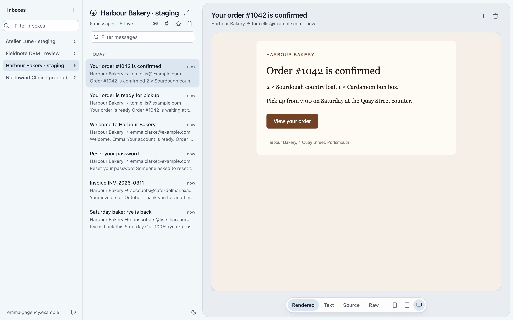
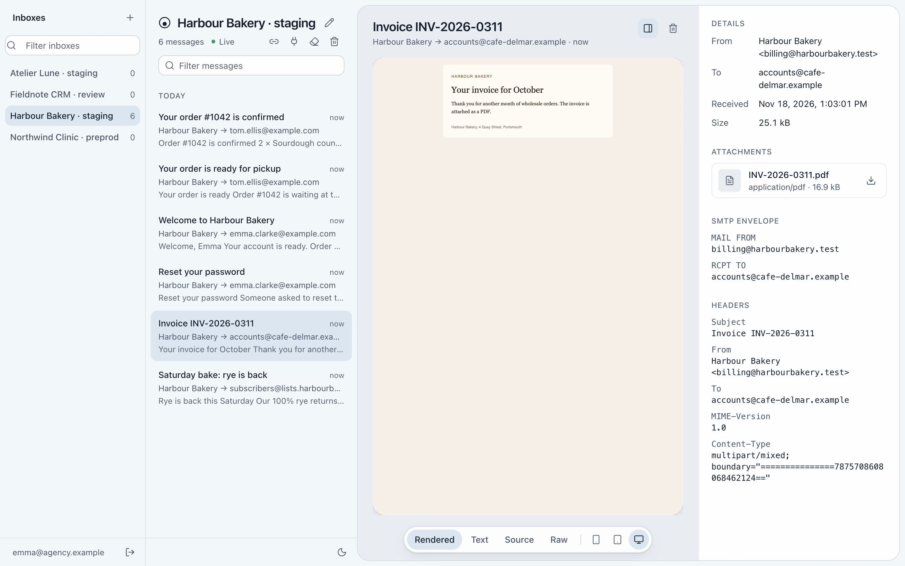
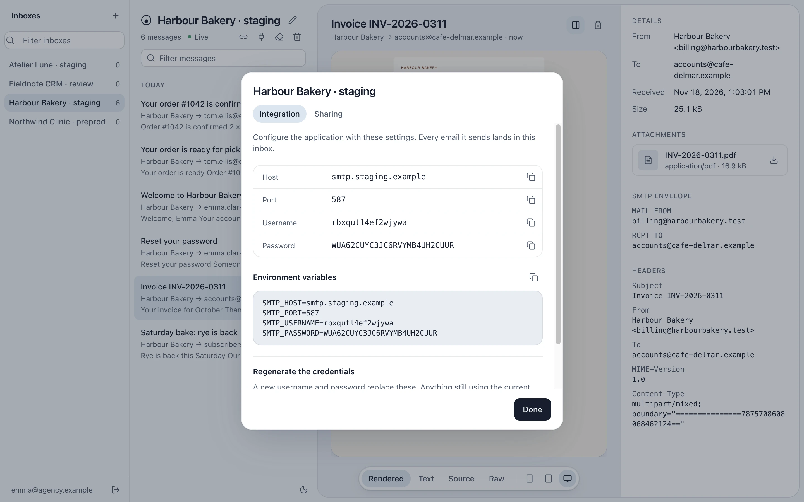
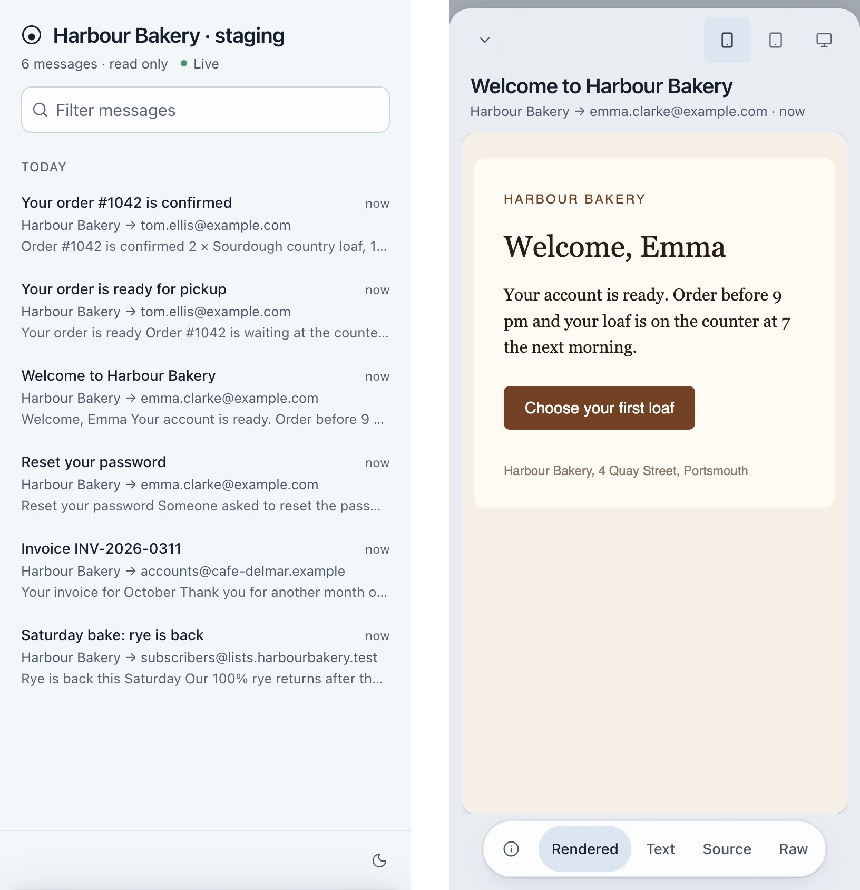

# Oubliette

An oubliette is a dungeon you drop into through a trapdoor in the ceiling, and nobody comes back out. This one is for email. Your staging sites send their mail to it over SMTP, it keeps every Message, and none of them ever reaches a real person.

<picture>
  <source media="(prefers-color-scheme: dark)" srcset="https://raw.githubusercontent.com/akiletour/oubliette/main/docs/screenshots/main-dark.webp">
  
</picture>

Each staging Application gets its own Inbox, chosen by the Credentials it signs in with. The agency's Members see every Inbox. A customer gets a Share Link to their own Inbox and reads their emails without an account, so nobody has to forward screenshots any more.

It ships as one binary with the interface built in, and keeps everything in one SQLite file.

## The interface

### Every email as the customer will see it

Messages land in the list as they arrive, grouped by day, with a green Live dot that tells you the list is listening. The filter matches subject, sender and recipient. An email renders in a sandboxed frame with its scripts blocked, and the toggle under it narrows the frame to 375 px or 768 px to check the mobile layout. Text, Source and Raw show the same Message as the Application sent it.

The theme follows your system, or the moon button. The language follows the browser, in English or French.

### What the Application actually sent



The details panel shows the headers, the attachments and the SMTP envelope. The envelope is where the surprises are: a recipient in `RCPT TO` who appears in no header is a Bcc your template didn't mean to send. Attachments always download, with a neutral type, so nothing in them runs in the browser.

### Plugging in an Application



The Integration tab gives the host, port, username and password, and the same four as environment variables to paste into the Application's `.env`. Regenerating them refuses the old pair at once, even on a connection that is already open.

### What the customer sees



A Share Link opens one Inbox, read-only, on a laptop or a phone. It can expire on a date, an Inbox can have several, and revoking one leaves the others working. The sharing tab shows when each link was last opened.

## Try it on your machine

Start it without encryption, which is fine on your own machine:

```sh
docker run -d --name oubliette -p 8080:8080 -p 1025:1025 \
  -e OUBLIETTE_SMTP_INSECURE_AUTH=true akiletour/oubliette
```

The image is on Docker Hub as `akiletour/oubliette` and on GitHub as `ghcr.io/akiletour/oubliette`, for amd64 and arm64. Each [release](https://github.com/akiletour/oubliette/releases) also has the binary on its own, for Linux, macOS and Windows.

Create yourself a Member. It asks for the password twice:

```sh
docker exec -it oubliette oubliette member add you@example.com
```

The first start creates an Inbox called Default and logs its Credentials once:

```sh
docker logs oubliette | grep smtp_username
```

Send it something, then open http://localhost:8080 and sign in:

```sh
printf 'Subject: Hello from staging\r\n\r\nIt works.\r\n' > hello.eml
curl --url smtp://localhost:1025 --user USERNAME:PASSWORD \
  --mail-from app@example.com --mail-rcpt someone@example.com --upload-file hello.eml
```

## Running it for real

```sh
docker volume create oubliette-data
docker run -d --name oubliette \
  -p 8080:8080 -p 1025:1025 \
  -v oubliette-data:/data \
  -v /etc/oubliette/tls:/tls:ro \
  -e OUBLIETTE_SMTP_TLS_CERT=/tls/tls.crt \
  -e OUBLIETTE_SMTP_TLS_KEY=/tls/tls.key \
  akiletour/oubliette
```

The image runs as the non-root user 65532 and keeps its data file at `/data/oubliette.db`. A named volume works as is. A host directory mounted on `/data` must be writable by user 65532, and the certificate files must be readable by that user.

To create Members from a script, pass the password on standard input:

```sh
printf '%s\n' "$PASSWORD" | docker exec -i oubliette oubliette member add you@example.com
```

`member list`, `member remove <email>` and `member set-password <email>` manage the other accounts. There is no sign-up and no password reset by email. Members exist only when the Operator creates them.

### SMTP encryption

The server won't start without a certificate (`--smtp-tls-cert` and `--smtp-tls-key`) or the override `--smtp-insecure-auth`. With a certificate, Applications must use STARTTLS before they authenticate, unless the override is also set. In that case the override wins and the server logs a warning at start, so remove the override when you add a certificate. The files are read again at each TLS handshake, which means a certificate renewed by cert-manager or ACME is picked up without a restart.

Behind a reverse proxy, SMTP needs its own TCP port. STARTTLS begins in cleartext, so a proxy can't route it by SNI. Two setups work:

- The proxy passes the TCP connection through, and Oubliette does STARTTLS with a mounted certificate. That can be a cert-manager Secret, Caddy's PEM files on a shared volume, or a certificate extracted from Traefik's `acme.json`.
- The proxy terminates implicit TLS on port 465 and forwards cleartext to Oubliette, which then runs with `--smtp-insecure-auth` on the private network behind it.

The web interface is served in plain HTTP. Let the reverse proxy terminate TLS for it.

## Settings

Every flag has an environment variable with the `OUBLIETTE_` prefix, and the flag wins when both are set. There is no configuration file. `oubliette --help` prints the same list.

| Flag | Variable | Default | Meaning |
| --- | --- | --- | --- |
| `--data` | `OUBLIETTE_DATA` | `oubliette.db` | The data file. The image sets it to `/data/oubliette.db`. |
| `--http-addr` | `OUBLIETTE_HTTP_ADDR` | `:8080` | Address the web interface listens on, in plain HTTP. |
| `--smtp-addr` | `OUBLIETTE_SMTP_ADDR` | `:1025` | Address the SMTP server listens on. |
| `--smtp-tls-cert` | `OUBLIETTE_SMTP_TLS_CERT` | none | PEM certificate the SMTP server offers through STARTTLS. |
| `--smtp-tls-key` | `OUBLIETTE_SMTP_TLS_KEY` | none | PEM private key of that certificate. |
| `--smtp-insecure-auth` | `OUBLIETTE_SMTP_INSECURE_AUTH` | `false` | Accept SMTP authentication without encryption. Only on a private network. |
| `--smtp-advertised-host` | `OUBLIETTE_SMTP_ADVERTISED_HOST` | the host of the page | SMTP host shown in the Integration tab. |
| `--smtp-advertised-port` | `OUBLIETTE_SMTP_ADVERTISED_PORT` | the listening port | SMTP port shown in the Integration tab. |
| `--retention-days` | `OUBLIETTE_RETENTION_DAYS` | `30` | Days a Message is kept before it is purged, from 1 to 36500. |
| `--inbox-cap` | `OUBLIETTE_INBOX_CAP` | `1000` | Messages an Inbox holds, the oldest leaving first, from 1 to 1000000. |
| `--max-message-mb` | `OUBLIETTE_MAX_MESSAGE_MB` | `25` | Largest Message accepted, in MB of 1,048,576 bytes, from 1 to 100. |

A boolean takes `true` or `false`. A value Oubliette can't read stops the server at start, with a message naming the setting.

## Looking after it

`GET /healthz` answers `200` without authentication, for the platform's probes. Logs go to standard output, one `key=value` line per event.

On `SIGTERM` or `SIGINT`, which is what `docker stop` sends, Oubliette:

1. stops accepting connections;
2. closes the SMTP connections that aren't sending a Message;
3. lets a Message whose sending has begun (`MAIL FROM` answered) finish, for up to 8 seconds, then closes that connection;
4. closes the data file with every write in it.

A Message still arriving after 8 seconds is not kept. Its Application gets no `250` and should send it again, and Oubliette exits with status 1. Give the platform a grace period of at least 10 seconds, which is Docker's default.

### Backups

While the server runs, recent writes sit in a `-wal` file next to the data file, so a copy of the data file alone can miss them or be inconsistent. Stop the server, copy the file, start it again. After a clean stop the data file holds everything on its own.

```sh
docker stop oubliette
docker run --rm -v oubliette-data:/data -v "$PWD":/backup alpine cp /data/oubliette.db /backup/
docker start oubliette
```

To restore, put the copy back as the data file while the server is stopped.

## Building from source

```sh
make build
```

This builds the interface and produces `./oubliette`, a static binary built without CGO. It needs Go 1.27 and Node 24. `docker build -t oubliette .` builds the image instead and needs only Docker. `make test` runs `go vet` and the tests, which drive a real server over real SMTP and HTTP.

## What it won't do

Oubliette never delivers, relays or forwards a Message, and has no setting that would make it. It has no POP3 or IMAP, no search inside bodies, and no read or unread state. Customers get Share Links rather than accounts, and the whole state lives in one file written by one process, so it doesn't run as several replicas.
